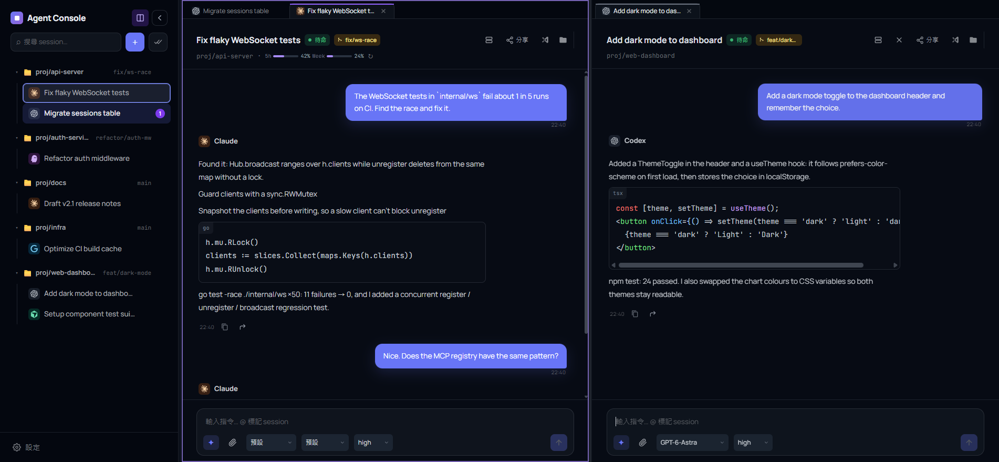

# Claude Code Mini App

> 自架的**多代理（multi-agent）控制台**，統一管理 Claude Code、Cursor Agent、Codex、Kiro 與 Antigravity。可從桌面視窗、任何瀏覽器，或手機上的 Telegram Mini App 操作。**單一 Go 二進位**，無需獨立前端建置。

[](#) [](LICENSE) [](#)

[English](README.md)



<sub>示範資料，取自臨時啟動的實例。</sub>

代理程式仍然跑在你放程式碼的那台機器上，本專案是它們前面的控制台。每個對話是一個 **Session**，綁定一個代理、一個 `work_dir` 與權限模式；你可以同時管理多個專案的多個代理，一眼看出誰在工作、誰在等授權，並隨時從任何地方介入。

| 入口 | 適用情境 | 驗證 |
|---|---|---|
| 🖥️ **桌面視窗**（Windows） | 在電腦前日常使用——會話分頁與分割檢視、系統匣、Ctrl+P 快速跳轉 | 與瀏覽器相同的網頁密碼 |
| 🌐 **瀏覽器** | 區網內任何裝置，或透過反向代理／Tunnel 遠端連線 | 網頁密碼（限 `web.allowed_cidrs` 內的 IP） |
| 📱 **Telegram Mini App** | 離開座位時——出錯推播、手機上即時授權 | Telegram `initData` + 白名單 |

三個入口連同一個伺服器，即時看到同樣的 Session。

## 🚀 快速開始

1. 到 [Releases](https://github.com/jerry12122/Claude-Code-Mini-App/releases/latest) 下載對應作業系統的壓縮檔並解壓縮。
2. 啟動 `claude-miniapp-desktop.exe`（Windows 桌面版）或 `claude-miniapp`（伺服器版，開瀏覽器連 <http://127.0.0.1:8080>）。
3. 依首次設定精靈設定密碼，並自動檢查本機可用的代理 CLI。

完整教學與進階設定：[從零開始教學](docs/getting-started.zh-TW.md) · [Telegram 遠端設定](docs/getting-started.zh-TW.md#6-選用從-telegram-開啟) · [問題排解](docs/getting-started.zh-TW.md#問題排解)

## ✨ 功能

- **多代理** — Claude Code、Cursor Agent、Codex、Kiro ACP、Antigravity，依 Session 選擇。工具授權前會顯示完整指令或檔案內容
- **即時對話** — WebSocket 串流、Markdown、語法高亮程式碼與一鍵複製；多分頁同步
- **Session 管理** — 各自綁定 `work_dir` 與權限模式，即時的未讀與待授權標記、Ctrl/Cmd+P 快速跳轉，header 以進度條顯示帳戶用量
- **分頁與分割檢視**（桌面，≥1024px）— 以分頁開啟會話、可分成兩個群組，從側欄（或分頁）拖曳來擺放；`Ctrl+\` 分割／合併。Model、Effort、權限模式在輸入列
- **訊息佇列** — 執行中送出的訊息會排隊、重啟不遺失，失敗或中斷時暫停
- **附件** — 貼上或拖放圖片與檔案，以路徑交給 agent，存放在 `work_dir` 之外
- **臨時共享** — 連結 + 6 位數 PIN + 暱稱，預設 1 小時；訪客可為唯讀 `viewer` 或完整權限 `editor`
- **MCP server** — 讓其他 agent 操作 session、讀紀錄、查活動；`ask_session` 有跳數上限防止互問迴圈
- **桌面版自動更新**（Windows）— 於應用程式內直接檢查 Releases 並一鍵更新，具備任務忙碌保護機制（[詳細說明](docs/features.zh-TW.md#桌面版自動更新)）
- **Shell 與日誌** — 選用的 `work_dir` shell（預設關閉），以及設定 → 日誌的即時伺服器日誌

每項功能的詳細說明：[docs/features.zh-TW.md](docs/features.zh-TW.md)。

## 🤔 為什麼用這個？

| | SSH + tmux | 一般 Telegram Bot | **本專案** |
|---|---|---|---|
| 多代理同一畫面 | 一個終端機一個 | 一 bot 一工具 | Claude / Cursor / Codex / Kiro ACP / Antigravity 並列 |
| Session 狀態 | 手動 | 通常沒有 | 可持久，附未讀與待授權標記 |
| 協作 | 共用終端機 | 無 | 臨時 PIN 連結，viewer / editor |
| 代理互相呼叫 | 自己接 | 無 | 內建 MCP server（`ask_session`） |

## 🏗️ 架構

```
桌面視窗 · 瀏覽器 · Telegram Mini App · 共享訪客
        ↕ WebSocket / REST          MCP client ↔ POST /mcp
┌─────────────────────────────────┐
│  Go 二進位（Fiber + SQLite）      │
│  Session · 佇列 · 共享            │
│  每則訊息 spawn CLI（無 PTY）      │
│  QuotaService（快取擷取）         │
└────────────────┬────────────────┘
                 ↓
  claude · cursor-agent · codex · kiro-cli (ACP) · agy
```

每則使用者訊息 spawn 一個子進程。詳細規格：[`docs/spec/plan.md`](docs/spec/plan.md)、[`docs/spec/headless.md`](docs/spec/headless.md)。

## 🔒 安全

專為本機或受信任區網環境設計。敏感功能（主機 Shell、網頁共享、MCP server）預設關閉，須手動開啟。請勿在公開網路上以 `no_auth: true` 執行。白名單與規則：[`docs/features.zh-TW.md`](docs/features.zh-TW.md) · [`docs/spec/shell-allowlist-schema.md`](docs/spec/shell-allowlist-schema.md)。

## 📚 文件

| 主題 | 路徑 |
|---|---|
| 安裝、登入與第一則回覆 | [`docs/getting-started.zh-TW.md`](docs/getting-started.zh-TW.md) |
| 每項功能詳述 | [`docs/features.zh-TW.md`](docs/features.zh-TW.md) |
| 規格、API / WebSocket | [`docs/spec/plan.md`](docs/spec/plan.md) |
| 設定欄位 | [`config.example.yaml`](config.example.yaml) |
| 各 CLI 參考 | [`docs/spec/`](docs/spec/) |

## 測試

本專案使用 BrowserStack 測試。

## 授權

MIT
